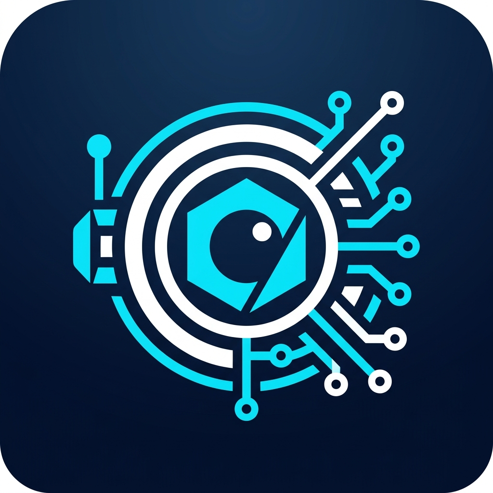
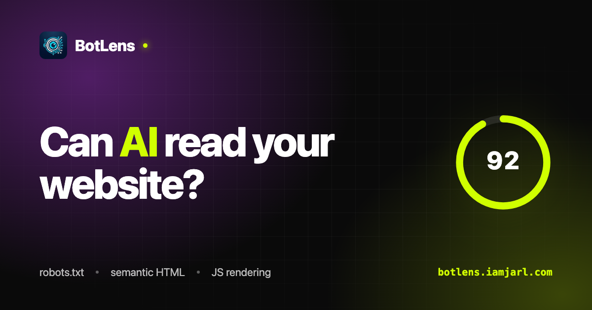

# BotLens

Can AI read your website?

<!-- IAMJARL README store block for BotLens (en). Generated from apps.json, v1.34.0. Do not edit. -->
<p>
  <a href="https://chromewebstore.google.com/detail/botlens/lpopnolnbpkmealenachikdfkfeaoecl?utm_source=github"><picture>
    <source media="(prefers-color-scheme: dark)" srcset="https://raw.githubusercontent.com/JarlLyng/iamjarl-design/v1.34.0/badges/chrome-web-store-border.png">
    
  </picture></a>
  <br>
  Free · <a href="https://botlens.iamjarl.com">botlens.iamjarl.com</a>
</p>

<p>
  
</p>

BotLens is a Chrome extension that checks whether AI crawlers can read and understand the page you have open, and scores it from 0 to 100. It looks at the site's robots.txt rules for 24 AI bots, GPTBot and ClaudeBot among them, the page's meta tags and HTML structure, and whether its content needs JavaScript to appear. It is for developers and site owners. It runs in your browser, and its only requests go to the site you are checking.

## For developers

<p>
  <a href="https://madebyhuman.iamjarl.com"><picture>
    <source media="(prefers-color-scheme: dark)" srcset="https://madebyhuman.iamjarl.com/badges/co-created-white.svg">
    </picture></a>
  <a href="https://github.com/JarlLyng/BotLens/actions/workflows/lint.yml"></a>
  <a href="LICENSE"></a>
</p>

### The goal

More and more of the web is read by AI systems, which raises a question for anyone who runs a site: can AI read this page?

BotLens answers it by inspecting the technical signals that decide whether systems like GPTBot and ClaudeBot can interpret a page: `robots.txt` directives, meta tags, semantic HTML, structured data and JavaScript rendering.

### What it checks

- **AI readability score:** 0 to 100. It starts at 100 and loses points in three categories: robots.txt and meta directives (up to 50), content structure, and JS rendering (up to 20).
- **robots.txt:** multiple user-agent groups, Allow/Disallow precedence by longest match, `*` wildcards and `$` end-of-path anchors, checked against 24 AI user-agents such as `GPTBot`, `ClaudeBot`, `PerplexityBot`, `Google-Extended` and `Bytespider`.
- **Meta directives:** `noindex`, `nofollow`, `none`, the `noai` and `noimageai` AI-training opt-outs, and bot-specific meta tags.
- **Content structure:** heading hierarchy, HTML5 landmarks, image alt-text coverage, JSON-LD and its schema types, `<html lang>`, and Open Graph, Twitter Card and canonical tags.
- **JS rendering:** compares the page's served HTML to the rendered DOM to catch SPA shells that give crawlers a near-empty page.
- **Details panel:** every issue and the data behind the score, such as each blocked bot and every meta directive, plus the sitemap, `llms.txt`, `llms-full.txt`, and content provenance (generator meta, schema.org `digitalSourceType`, IPTC image metadata). These extras are reported, not scored.
- **Local:** no account, no telemetry, no server. Every request the extension makes goes to the site you are checking.

### Web demo

The site can check an address without the extension. A small Vercel Function (`api/check.js`)
fetches the page and its robots.txt once and scores them with the extension's own code. It
stores no addresses or results, only hashed rate-limit counters in Turso. The extension itself
has no backend.

### Technical stack

- **Manifest V3:** the current Chrome extension platform
- **Vanilla JavaScript:** no frameworks, no build step to load unpacked
- **Design tokens:** [iamjarl-design](https://github.com/JarlLyng/iamjarl-design), bundled in [`tokens.css`](tokens.css)
- **Icons:** inline SVG, with nothing loaded from a CDN
- **Website:** GitHub Pages, deployed automatically from [`website/`](website/)

### Build and run

```bash
npm install          # install dev dependencies
npm run lint         # ESLint (also runs in CI)
npm test             # parser and scoring tests (also runs in CI)
npm run build        # produce dist/botlens-<version>.zip for the Web Store
```

Load it unpacked in any Chromium browser (Chrome, Edge, Brave and others):

1. Clone this repository.
2. Open `chrome://extensions/`.
3. Turn on **Developer mode** (top right).
4. Click **Load unpacked** and select the project folder.

Coding conventions:

- Follow the tokens in [`tokens.css`](tokens.css) for anything UI-related.
- Keep the popup logic in [`popup.js`](popup.js) and the injected page extractor in [`content.js`](content.js).
- Do not add remote script dependencies. MV3 forbids it and Chrome Web Store review rejects it.

### Releasing

Publishing to the Chrome Web Store is automated via GitHub Actions ([`.github/workflows/publish.yml`](.github/workflows/publish.yml)):

```bash
# 1. Bump "version" in manifest.json + update CHANGELOG.md, commit
# 2. Tag and push:
git tag v1.2.0 && git push origin v1.2.0
# → CI lints, builds, uploads to the Web Store, and submits for review
```

The workflow can also be run manually from the Actions tab. `check` (the default) verifies
that publishing works and uploads nothing; `draft` uploads without submitting.

Publishing is keyless. GitHub's OIDC token is exchanged for a short-lived Google access token
(Workload Identity Federation), so there is no token to renew. It needs one secret,
`CWS_EXTENSION_ID`, and three repository variables: `CWS_PUBLISHER_ID`, `CWS_WIF_PROVIDER` and
`CWS_SERVICE_ACCOUNT`. The manual devconsole upload remains a valid fallback if the API flow
ever breaks.

### Roadmap

Tracked in [GitHub issues](https://github.com/JarlLyng/BotLens/issues), among them CMS, framework, hosting and analytics detection under the `v3` label, and a Safari and Firefox port ([#25](https://github.com/JarlLyng/BotLens/issues/25)).

### Contributing

See [CONTRIBUTING.md](CONTRIBUTING.md). Bug reports, feature requests, and pull requests are all welcome. Issues use structured templates.

### Feedback and support

Email [support@iamjarl.com](mailto:support@iamjarl.com), or use **Send feedback** at the bottom of the popup. Bug reports and feature requests are also welcome as [GitHub issues](https://github.com/JarlLyng/BotLens/issues).

### Security

See [SECURITY.md](SECURITY.md). Please **do not** open public issues for vulnerabilities. Use GitHub's [Private Vulnerability Reporting](https://github.com/JarlLyng/BotLens/security/advisories/new).

### License

MIT. See [LICENSE](LICENSE). BotLens is made and maintained by Jarl at [IAMJARL](https://iamjarl.com).
